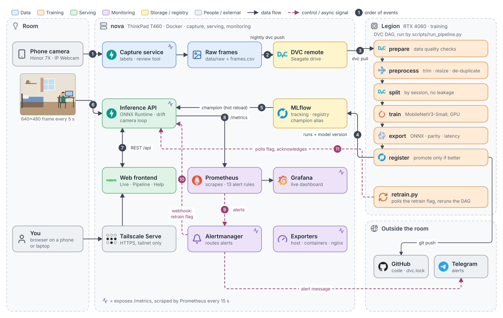

# RoomSense

Classifies the state of a hostel room (`at_desk`, `lying_in_bed`, `sitting_on_bed`, `in_room`, `empty`, `lights_off`) from a phone camera, with the full MLOps loop around it: versioned data, a reproducible pipeline, a model registry, CPU serving, monitoring, drift alerts and retraining. Everything runs on my own machines. Nothing runs in the cloud.



**Demo video:** [watch on Google Drive](https://drive.google.com/file/d/1YcPyV3smMiM-jK5kJkJ4iBxO_-0Pdiks/view?usp=sharing) (about 11 minutes)

**Documents** (in [`docs/`](docs/README.md)): [architecture](docs/01-architecture.md) · [high-level design](docs/02-hld.md) · [low-level design with the API specification](docs/03-lld.md) · [test plan](docs/04-test-plan.md) · [test report](docs/05-test-report.md) · [user manual](docs/06-user-manual.md)

All web UIs are reachable only inside the tailnet (Tailscale Serve, HTTPS). Every Docker port is bound to `127.0.0.1`.

## The cogs

| Cog | Where | Input → Output |
|---|---|---|
| `capture/` | nova | camera frames + label buttons → `data/raw/<session>/*.jpg`, `frames.csv`; review tool for curation |
| `prepare` | Legion (DVC) | `data/raw` → `manifest.csv` (missing files dropped, day/night added) |
| `preprocess` | Legion (DVC, Ray) | manifest → trimmed, resized 224×224, de-duplicated frames (k-means per session) |
| `split` | Legion (DVC) | clean manifest → `splits.csv`, split **by session** (no leakage), optional `data.include` filter |
| `train` | Legion (DVC, GPU) | splits → `models/best.pt` + `calibration.json`, MLflow run (params, curves, test macro-F1, confusion matrix, PyTorch model). Class/session-balanced sampling, label smoothing, frozen-head warm-up then fine-tune, colour augmentation, early stopping, temperature calibration |
| `export` | Legion (DVC) | checkpoint ÷ temperature → `model.onnx` (serves calibrated confidences) + parity check + CPU latency + reference stats for drift |
| `register` | Legion (DVC) | ONNX → MLflow registry version; promoted to alias `champion` only if it beats the current champion **on test sessions neither model trained on** |
| `mlflow` | nova (Docker) | tracking server + model registry (sqlite + artifact store) |
| `api` | nova (Docker) | champion model (hot-reloaded) + camera frames → predictions, `/metrics`, drift + live accuracy |
| `frontend` | nova (Docker) | separate nginx container: live frame, room state, drift monitor, model card, photo upload |
| `prometheus` + `alertmanager` | nova (Docker) | metrics → alerts (drift, confidence, accuracy, API/camera down) → Telegram + retrain webhook |
| `grafana` | nova (Docker) | provisioned "RoomSense: live model monitoring" dashboard |
| `retrain.py` | Legion | retrain flag → `dvc repro` → new champion → ack |

## Drift → retrain, in one paragraph

Every camera frame's brightness goes into a rolling window (120 frames, about 10 minutes). The API compares the window with the training frames: the **unseen-lighting share** is the share of recent frames whose brightness falls in a range the model (almost) never saw in training. When it stays above 50 % for 5 minutes, Prometheus fires `RoomSenseDrift`. Alertmanager notifies Telegram and calls the API webhook, which raises the **retrain flag**. On the Legion, `scripts/retrain.py` sees the flag, pulls the newest nightly snapshot, reruns the pipeline, and the `register` stage promotes the new model if it beats the old one on test sessions neither has trained on. The API hot-reloads the new champion within a minute. Its reference statistics now cover the new lighting, so the drift signal drops back. PSI is also computed and shown, but it isn't used for alerting, because on a short window it is high even without drift. While a capture session is recording, its label is used as ground truth, so the dashboard also shows **live accuracy**.

**Demo recipe:** set `data.include: {lighting: [tube_on]}` in `params.yaml`, `dvc repro`, and the champion now only knows the tube-light-on room. Switch the tube light off: within about 10 minutes the drift alert fires and a retrain is requested. Set `data.include: {}`, run `python scripts/retrain.py`, and the alert resolves.

## Results

| | |
|---|---|
| Dataset | 56,796 labelled frames in 108 sessions, 6 classes |
| Serving model | v2 (champion): MobileNetV3-Small in ONNX, under 3 ms per prediction on 2 CPU threads (p95) |
| Pipeline | All six stages in about 2 minutes on the Legion; Ray resizes about 6,600 frames/s |
| Tests | 91 of 91 pass; `ruff` clean |
| Acceptance criteria | 13 of 14 met. AC-3 (macro-F1 ≥ 0.60) is not met by the final model, v5 (0.518), which therefore was not promoted. The reason is the small, reshuffling test split; see [the test plan](docs/04-test-plan.md#result-of-the-final-run-14-nov-2026). |

## Repository layout

| Path | What |
|---|---|
| `capture/` | Data ingestion service (FastAPI): label buttons, review tool, `/metrics` |
| `roomsense/` | Shared library used by training and serving: preprocessing, drift, calibration, metrics, registry |
| `scripts/` | The six DVC stages, the pipeline runner, retrain, rollback, test report, nightly snapshot |
| `dvc.yaml`, `params.yaml`, `dvc.lock` | The pipeline (DAG), its parameters, and the exact versions of its last run |
| `data/raw.dvc` | Fingerprint of the dataset version (the images themselves are not in Git) |
| `MLproject`, `python_env.yaml` | MLflow Project: entry points and the one Python environment |
| `deploy/` | Serving and monitoring stack (Docker Compose), Prometheus rules, Grafana dashboard, systemd timer |
| `tests/` | 91 automated tests |
| `docs/` | Architecture, HLD, LLD, test plan, test report, user manual, diagrams, PDFs |

## Setup

RoomSense runs on two Ubuntu 26.04 machines joined by a Tailscale network:

- **nova** (any always-on Linux box, 8 GB RAM is enough): Docker + Compose, Tailscale, Python 3 with `dvc`, and the dataset drive mounted at `/mnt/photos`.
- **Legion** (training, NVIDIA GPU): Python 3.12, `uv`, CUDA drivers, Tailscale, SSH access to nova.

**Data.** The images are pictures of a private room, so they are not in this repository. They live on nova (`data/raw/`) and in the DVC remote on nova's drive (`/mnt/photos/dvc-store`, see `.dvc/config`). Git holds only `data/raw.dvc`, the fingerprint of each dataset version. The Legion reaches the same remote over SSH. Everything except training on the real data (the tests, the services, the UI) works without the images.

### 1. nova: capture, serving and monitoring

```bash
git clone git@github.com:raisserv2/roomsense.git ~/roomsense && cd ~/roomsense
pip install --user dvc

docker network create roomsense                 # shared by capture and the serving stack

cp capture/.env.example capture/.env && chmod 600 capture/.env && nano capture/.env   # camera URL + login
(cd capture && docker compose up -d --build)    # capture service on 127.0.0.1:8100

cd deploy
cp .env.example .env && chmod 600 .env && nano .env   # CAM_PASS, Telegram token + chat id, Grafana password
mkdir -p data/{mlflow,api,prometheus,alertmanager,grafana}
docker compose up -d --build                    # 9 services
docker compose ps

# HTTPS inside the tailnet only (Funnel stays off)
sudo tailscale serve --bg --https=4443 http://127.0.0.1:8200   # RoomSense UI
sudo tailscale serve --bg --https=5443 http://127.0.0.1:5000   # MLflow
sudo tailscale serve --bg --https=3443 http://127.0.0.1:3300   # Grafana
sudo tailscale serve --bg --https=6443 http://127.0.0.1:9091   # Prometheus
sudo tailscale serve --bg --https=7443 http://127.0.0.1:8100   # capture

# nightly dataset snapshot at 03:30 (DVC add + push to the drive, Git push of the fingerprint)
sudo cp ~/roomsense/deploy/systemd/roomsense-snapshot.* /etc/systemd/system/
sudo systemctl daemon-reload && sudo systemctl enable --now roomsense-snapshot.timer
```

Then open `https://nova.<tailnet>.ts.net:7443` on the phone and record labelled sessions. Never run `dvc pull` or `dvc repro` on nova: it owns the live data.

### 2. Legion: training

```bash
git clone git@github.com:raisserv2/roomsense.git ~/roomsense && cd ~/roomsense
uv venv --python 3.12 .venv && source .venv/bin/activate
uv pip install -r requirements.txt -r requirements-dev.txt "mlflow==3.17.2"
dvc remote modify --local seagate url ssh://raisser@nova/mnt/photos/dvc-store   # reach nova's drive over SSH
echo 'export MLFLOW_TRACKING_URI=https://nova.tailb5cb87.ts.net:5443' >> ~/.bashrc && source ~/.bashrc

pytest && ruff check .                          # 91 tests, PEP 8
dvc pull                                        # the dataset version pinned in data/raw.dvc
python scripts/run_pipeline.py                  # dvc repro + records the run in MLflow
dvc push && git add dvc.lock models/.gitignore reports && git commit -m "pipeline run" && git push
```

If the new model beats the champion, nova's API serves it within a minute, and `https://nova.tailb5cb87.ts.net:4443` shows the live room state.

### Day-to-day
| Task | Command |
|---|---|
| Rerun only what changed, and record the run | `python scripts/run_pipeline.py` (plain `dvc repro` also works, without the record) |
| Pipeline DAG | `dvc dag` |
| Compare runs | MLflow UI (`:5443`) or `dvc metrics show` |
| Retrain when drift is flagged | `python scripts/retrain.py` (or `--watch 10` to keep polling) |
| Retrain now | `python scripts/retrain.py --force` |
| Roll back to the previous model | `python scripts/rollback.py` (`--list`, `--to 2`), or the button on the Pipeline page |
| Run via MLproject | `mlflow run . -e main --env-manager local` (also `-e train -P epochs=3`) |
| Same environment for dev and test | `mlflow run . -e test` builds the env from `python_env.yaml` and runs the tests in it |
| MLflow's own model server | `docker compose --profile mlflow-serve up -d mlflow-serve`, then `python scripts/mlflow_serve_request.py photo.jpg` |
| Tests | `pytest` |
| Tests + lint + acceptance criteria → `docs/05-test-report.md` | `python scripts/test_report.py` (add `--api https://nova.tailb5cb87.ts.net:4443/api` for the live checks) |
| Rebuild diagrams / PDFs | `python docs/diagrams/make_diagrams.py` · `python docs/build_pdfs.py` |

## API

Full specification with inputs, outputs and error codes: [docs/03-lld.md](docs/03-lld.md). Interactive docs at `/api/docs` on the UI host.

Live: `GET /health` · `GET /model` · `POST /predict` · `GET /latest` · `GET /latest.jpg` · `GET /drift`
Pipeline console: `GET /pipeline` · `GET /pipeline/runs` · `GET /pipeline/registry` · `POST /pipeline/rollback` · `GET /events`
Lifecycle: `POST /reload` · `POST /hooks/alertmanager` · `GET /retrain` · `POST /retrain/request` · `POST /retrain/ack`
Monitoring: `GET /metrics`

## Web UI

Three pages at `https://nova.tailb5cb87.ts.net:4443`: **Live room** (current state, confidence, drift, photo upload), **Pipeline** (the DAG with status and throughput per stage, controls for retrain / reload / rollback, data ingestion totals, every successful and failed run, model versions, activity log) and **Help** (the user manual). The frontend reaches the backend only through `API_UPSTREAM` and `API_BASE_URL` in `deploy/.env`.

## Monitoring

Prometheus scrapes eight jobs: the API, the capture service, the frontend (nginx exporter), the host (node-exporter), all containers (cAdvisor), and Prometheus, Alertmanager and Grafana themselves. 13 alert rules; drift and live-accuracy alerts carry `action=retrain`. The Grafana dashboard has rows for the model, the training pipeline, data ingestion, and components and host.

## Privacy

Frames never leave the room network and my own drives (Tailscale only, Funnel off, no cloud). The camera is covered when guests are in. Face blurring with a Haar detector was tried in `preprocess`, found unreliable (missed faces, blurred furniture), and is switched off (`blur_faces: false`). A stronger detector is future work.

## Use of AI

Claude (Anthropic) was used as a coding assistant: drafting code, tests, documentation and diagrams. The project idea, the design choices, the hardware and network setup, the data collection and labelling, running the training and the deployment, and checking every result are my own work.
