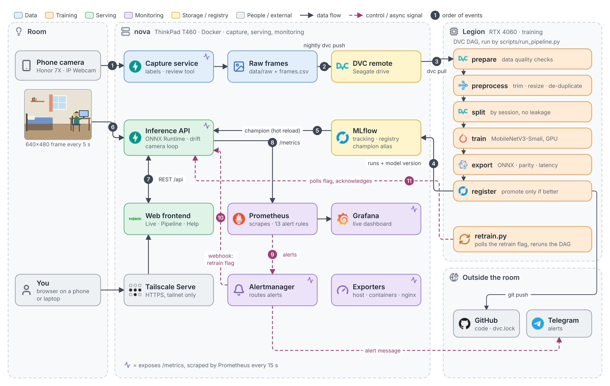
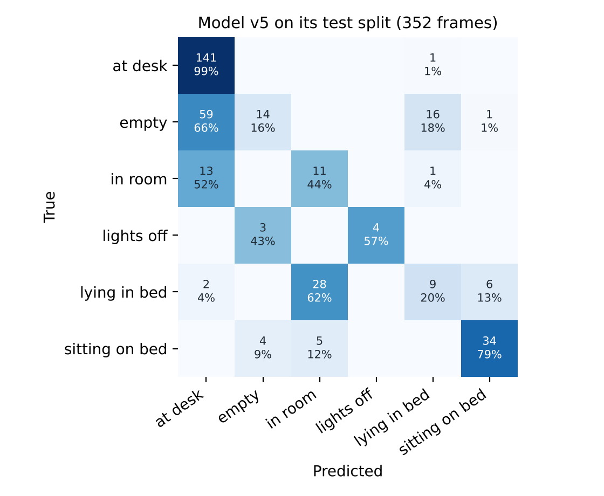
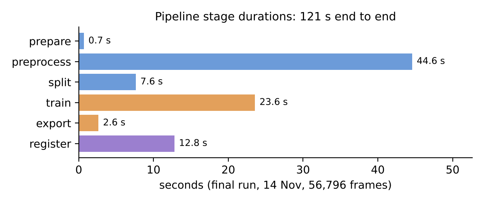

# RoomSense: project report

**Khaja Mohammed** · DA3408 AIOps · IIT Madras · November 2026

Repository: `github.com/raisserv2/roomsense` · Demo video: linked at the top of the README

This report tells the story of the project and its results. The detail lives in the five design documents, linked where they matter: [architecture](01-architecture.md), [high-level design](02-hld.md), [low-level design](03-lld.md), [test plan](04-test-plan.md), [test report](05-test-report.md) and [user manual](06-user-manual.md).

---

## 1. Problem and goal

RoomSense works out what is happening in a hostel room from a single phone camera, one picture every five seconds. It recognises six states: `at_desk`, `lying_in_bed`, `sitting_on_bed`, `in_room` (moving about), `empty`, and `lights_off`.

The model is the small part. The aim of the project was the full machine learning lifecycle around it, run like a production system: versioned data collection, a reproducible pipeline, experiment tracking, a model registry with a promotion rule, serving, monitoring of every component, drift detection, automatic retraining, and rollback. The course rules and the privacy of the pictures ruled out the cloud, so everything runs on two machines in the room:

| Machine | Role |
|---|---|
| **nova**, a ThinkPad T460 used as an always-on server (8 GB RAM, no GPU) | Collects pictures, serves the model, runs MLflow and all monitoring, in Docker |
| **Legion**, a laptop with an RTX 4060 GPU | Runs the training pipeline |

The two are joined by a private Tailscale network. Every web page is reachable only by the owner's devices.

## 2. System overview

The loop, in short:

1. A capture service on nova saves a labelled picture every 5 s while the owner records a session.
2. Every night nova versions the new pictures with DVC (Data Version Control) on a local drive and pushes the dataset fingerprint to GitHub.
3. On the Legion, a six-stage DVC pipeline checks the data, preprocesses it with Ray, splits it by session, trains, exports to ONNX and registers the model in MLflow.
4. The model is promoted to `champion` only if it beats the current one on pictures neither has seen. nova's API swaps it in without a restart.
5. Prometheus scrapes every component and Grafana shows them live. When live pictures drift away from the training data, an alert raises a retrain flag, the Legion picks it up, and the loop starts again.

Block-by-block explanations are in the [architecture document](01-architecture.md). The reasoning behind each choice is in the [HLD](02-hld.md).

## 3. Data

**Collection.** A phone page starts and stops labelled recording sessions, so pictures are labelled as they are taken, and nothing is saved outside a session. A review tool lets bad pictures be relabelled or moved to a trash folder, and every change is logged.

| | |
|---|---|
| Pictures | 56,796, from 20 Oct to 12 Nov 2026 |
| Sessions | 108 |
| Lighting | 37,560 with the tube light on, 19,236 off |
| Time of day | 32,258 day, 24,538 night |

| Class | Pictures | Sessions |
|---|---:|---:|
| empty | 27,170 | 31 |
| at_desk | 10,291 | 31 |
| lying_in_bed | 7,896 | 12 |
| sitting_on_bed | 5,367 | 20 |
| lights_off | 5,207 | 4 |
| in_room | 865 | 15 |

The classes are unbalanced, and sessions matter more than pictures: pictures five seconds apart are nearly identical, so a class with four sessions (`lights_off`) has far less real variety than its 5,207 pictures suggest.

**Quality checks.** The `prepare` stage checks every row (the file exists and is not empty, the label and lighting are known, the pair is possible, the timestamp parses, no duplicates). The pipeline fails if more than 5% of rows are bad. On the final dataset, 0 rows were dropped.

**Preprocessing.** Session edges are trimmed (walking to and from the phone). Pictures are resized to 224 × 224. Within each session, k-means on image embeddings keeps the picture nearest each cluster centre: 5 to 80 per session. That cut 56,202 pictures to 2,419 representative ones, so long sessions no longer dominate training.

**Splitting.** Whole sessions go to train, validation or test (70 / 15 / 15), balanced per class, so the model is never tested on a session it trained on. The final split: 1,696 / 371 / 352 pictures from 54 / 26 / 28 sessions, with every class in every split.

**Privacy.** Pictures stay on the two machines and a backup drive. GitHub holds only the dataset fingerprints. Face blurring was tried and dropped: Haar detectors missed faces in profile and in the dark, and a filter that works only some of the time gives false comfort (see the HLD, section 4.1).

## 4. Model and training

MobileNetV3-Small, pretrained on ImageNet and fine-tuned on the GPU: first the classifier head with the backbone frozen, then the whole network, with early stopping on validation macro-F1.

- **No flips or crops.** The desk is at the right edge of the picture and the bed at the left; position is the signal. Only colour jitter is used.
- **Balanced sampling and label smoothing** against the class imbalance and overconfidence.
- **Temperature calibration** on the validation set, so that confidence means something in the UI and the alerts.
- **Export to ONNX** with the temperature built in. The exported model must match PyTorch within 0.001 before it can be registered (final run: largest difference 5.6 × 10⁻⁶).

Every run is logged to MLflow with its settings, per-epoch curves, per-class scores, the confusion matrix and calibration figures, and tagged with its Git commit and DVC data version.

## 5. Experiments and results

### 5.1 Model versions

| Version | Date | Data | Own test macro-F1 | Outcome |
|---|---|---|---:|---|
| v1 | 28 Oct | 5 classes, 857 training pictures | 0.615 | First champion. Heavily skewed toward `at_desk`; 99% confident when wrong. |
| **v2** | early Nov | 6 classes, ~27k raw pictures; training v2.1 (balanced sampling, label smoothing, calibration) | 0.548 | **Champion, still serving.** The test split had no `lights_off` session, and the metric at the time counted that as an F1 of 0; over the five classes present it is about 0.66. |
| v3 | 12 Nov | ~57k raw pictures (twice the data) | 0.652 | Not promoted: 0.652 against v2's 0.731 on the same test split. That comparison was unfair (section 6). |
| v4 | 12 Nov | Same model as v3, re-registered under the fair rule | (0.652) | Not promoted: 0.488 against v2's 0.519 on 129 pictures unseen by both. |
| v5 | 14 Nov | 56,796 raw pictures (final run) | 0.518 | Not promoted: 0.432 against v2's 0.547 on 129 pictures unseen by both. |

Each version's score is on its own test split. Because the split changes as data grows, the scores across rows are not directly comparable: the promotion decisions in the last column are the comparable numbers.

### 5.2 The final model (v5) per class

| Class | F1 | Test pictures |
|---|---:|---:|
| sitting_on_bed | 0.81 | 43 |
| at_desk | 0.79 | 142 |
| lights_off | 0.73 | 7 |
| in_room | 0.32 | 25 |
| empty | 0.25 | 90 |
| lying_in_bed | 0.25 | 45 |
| **macro average** | **0.52** | 352 |

The confusion matrix shows two systematic errors:

- **An empty room is usually called `at_desk`** (59 of 90). With nobody in the picture, the desk area dominates, and `at_desk` is the class the model has seen most. Almost every true `at_desk` picture is right (141 of 142), which is the other side of the same bias.
- **`lying_in_bed` is usually called `in_room`** (28 of 45). Lying under a blanket changes the bed's outline only slightly from above.

Both point to the data rather than the network: more varied `empty` and `lying_in_bed` sessions (different clothes, blanket, desk clutter, time of day) would help more than a larger model.

**Calibration did not help v5.** The temperature fitted on the 371 validation pictures was 1.84, which made the model underconfident on test: expected calibration error rose from 0.081 to 0.160. With a validation set this small, calibration should be fitted with a cross-check or skipped when it does not improve validation ECE.

### 5.3 Pipeline speed and throughput

| Measure | Final run |
|---|---|
| Whole pipeline, 56,796 pictures | 121 s |
| Ray resize step | 6,573 pictures/s (24 CPU cores) |
| Ray k-means de-duplication | 5,541 pictures/s |
| Preprocess end to end | 1,445 pictures/s |
| Training | 1,248 images/s on the RTX 4060 |
| Prediction on nova's CPU (2 threads) | 1.35 ms per picture (p95) |
| ONNX model size | 6.1 MB |

DVC reruns only the stages whose inputs changed: a run with nothing new takes a few seconds, all stages taken from the cache.

## 6. Key finding: a fair promotion rule

The promotion rule compared the new model with the champion "on the same test split". When the dataset doubled, v3 lost to v2 by a wide margin (0.652 against 0.731), which made no sense for a model trained on twice the data.

The cause: the splitter reassigns sessions whenever the dataset grows. An analysis of v3's test split showed that **209 of its 338 test pictures (14 of 22 sessions) came from sessions v2 had trained on.** v2 was being tested largely on its own training data.

The fix (in `registry.fair_comparison_set` and the register stage):

- Every registered model stores its split in MLflow.
- A candidate is compared with the champion **only on test sessions the champion never trained or validated on**, which are unseen by both.
- With fewer than 50 such pictures, the rule declines to promote and says why.

Under the fair rule, v2's score on the same candidate data fell from 0.731 to 0.519. v3 still did not beat it (0.488), and neither did v5 (0.432 against 0.547), so v2 remains the champion. On 129 pictures, mostly one session per class, those differences are within noise; the rule is correct, but the test set is too small to separate the models. The remaining fix is a "sticky" split that never moves an old session (section 9).

## 7. Serving, monitoring, drift and retraining

**Serving.** A FastAPI service on nova loads `models:/roomsense@champion` with ONNX Runtime, classifies the camera every 5 s, and checks the registry every 60 s; moving the alias is the whole deployment, and rolling back is moving it back (one click on the Pipeline page). The web frontend is a separate container that reaches the API only through REST, at an address set in configuration. The full API specification is in the [LLD](03-lld.md).

**Monitoring.** Prometheus scrapes eight jobs every 15 s: the API, the capture service, the frontend, the host, every container, and Prometheus, Alertmanager and Grafana themselves. A 42-panel Grafana dashboard covers the model, the training pipeline, data collection, and component health. Thirteen alert rules reach the owner's phone through Telegram.

**Drift.** The API compares the brightness of the last 120 pictures with the training pictures. The alert signal is the share of recent pictures in brightness ranges the training data almost never had: near 0 normally, near 1 when the lighting changes. The Population Stability Index is shown too, but proved too noisy on a 120-picture window to alert on. A second trigger compares live predictions with the label of a running recording session.

**Retraining.** A drift or accuracy alert calls the API's webhook, which raises a retrain flag saved on disk. The Legion polls the flag, pulls the newest data, reruns the pipeline, pushes the results and acknowledges. The demo video shows a real request raised by the live-accuracy alert while the Legion was off, waiting until the Legion picked it up.

**Pipeline console.** A Pipeline page in the web UI shows the pipeline as a diagram with each stage's status, duration and throughput, data collection totals, every successful and failed run, the model versions, and an activity log, with buttons to request retraining, reload and roll back.

## 8. Testing

| | |
|---|---|
| Automated tests | 91, all passing (unit, API, configuration) |
| Code style | `ruff`, PEP 8: no violations |
| Pipeline integration | Fresh run, fully cached run, and a forced failure, each recorded correctly |
| Acceptance criteria | 13 of 14 measured criteria met |

The one criterion not met is AC-3, test macro-F1 of the latest trained model ≥ 0.60: v5 reached 0.518. The threshold was kept rather than lowered after the result; sections 5 and 6 explain the cause. The test plan lists every case, and the generated test report gives each result.

## 9. Limitations and future work

- **Sticky split.** Keep each session in the split it was first assigned to, so test sessions stay unseen by every later model and comparisons grow more reliable over time.
- **More, more varied sessions** for `lights_off` (4 sessions), `lying_in_bed` and `empty`, which are the classes that limit macro-F1.
- **Calibration check.** Keep the temperature only if it improves validation calibration error.
- **Explainability.** Grad-CAM heat maps of what the network looks at would show directly whether `empty` is being judged from the desk.
- **Drift beyond brightness.** Distance in image-embedding space would catch changes that brightness cannot, such as furniture moving.
- **Scale.** PostgreSQL behind MLflow, object storage for DVC, and a canary step before promotion if the system had more users.

## 10. Use of AI

Claude (Anthropic) was used as a coding assistant: drafting code, tests, documentation and diagrams. The project idea, the design choices, the hardware and network setup, the data collection and labelling, running the training and the deployment, and checking every result are my own work.
