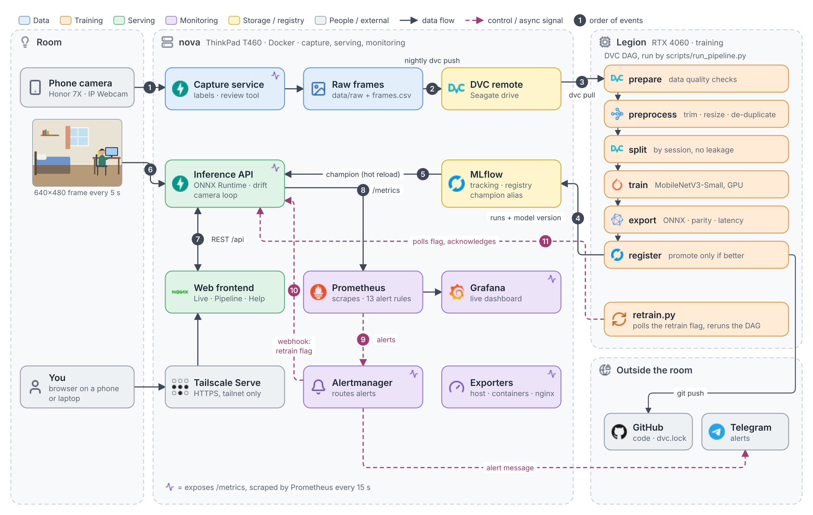
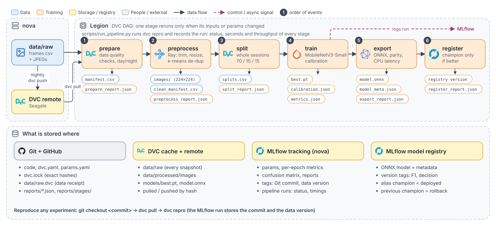
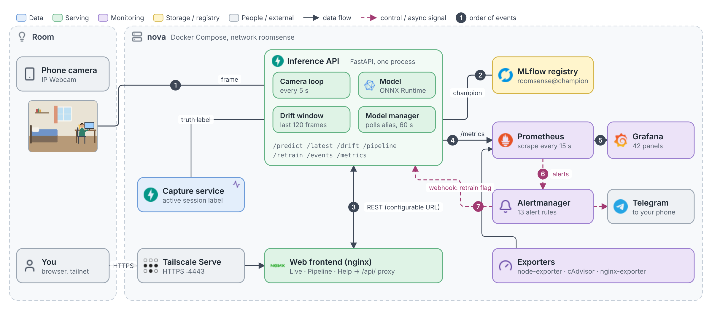
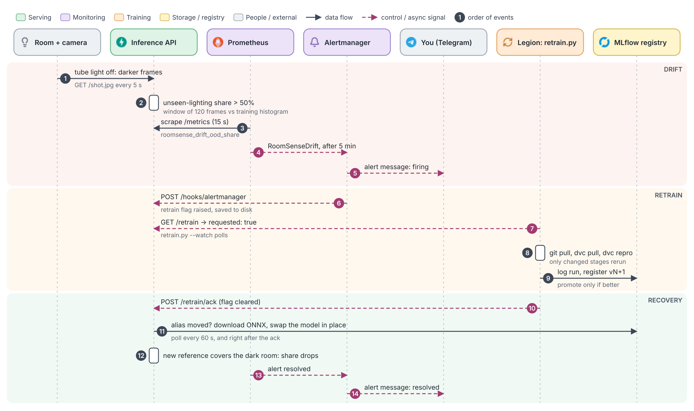
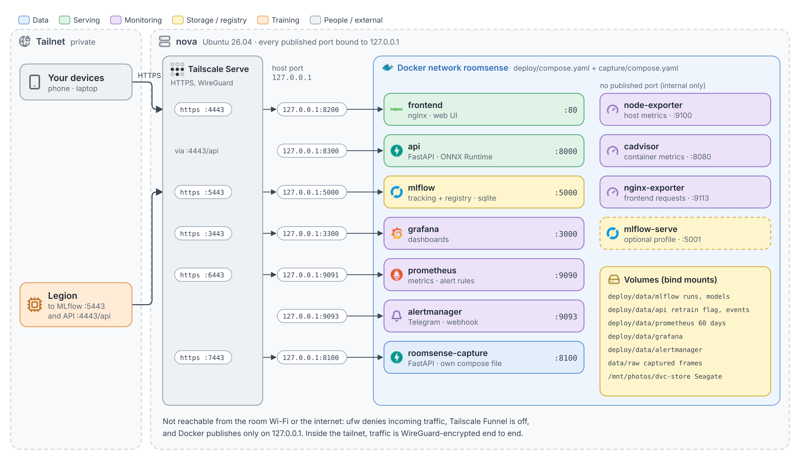

# RoomSense: architecture

RoomSense classifies the state of one hostel room from a phone camera, one frame every 5 seconds, into six classes: `at_desk`, `empty`, `in_room`, `lights_off`, `lying_in_bed`, `sitting_on_bed`. Around that model it runs the whole AIOps (Artificial Intelligence for IT Operations) loop: collect data, build a versioned pipeline, track experiments, serve, monitor, detect drift, retrain, recover.

Nothing runs in the cloud. Two machines in the room do everything, joined by a private Tailscale network (tailnet):

| Machine | Hardware | Job |
|---|---|---|
| **nova** | ThinkPad T460, 8 GB RAM, Ubuntu 26.04, no GPU | Data capture, serving, monitoring. Everything in Docker, every port bound to 127.0.0.1. On 24/7. |
| **Legion** | Laptop with an RTX 4060 GPU, Ubuntu 26.04 | Training. Runs the DVC (Data Version Control) pipeline. On only when training. |

## 1. System architecture

**The loop, by number:**

1. The phone camera hands a frame to the capture service every 5 s, only while a labelled recording session runs.
2. Every night nova snapshots the raw frames into the DVC remote (a Seagate drive) and pushes the data receipt (`data/raw.dvc`) to GitHub.
3. The Legion pulls that exact dataset version.
4. The DVC pipeline trains a model, logs the run to MLflow on nova, and registers a new model version.
5. If the new version beats the current one, the `champion` alias moves to it and the API hot-reloads the model without a restart.
6. The API also fetches a live frame every 5 s and classifies it.
7. The web frontend shows the result. It talks to the API only through REST (Representational State Transfer) calls.
8. Prometheus scrapes metrics from the API and every other component every 15 s; Grafana draws them.
9. When the live frames stop looking like the training data (drift), a Prometheus alert fires.
10. Alertmanager calls the API's webhook, which raises a "retrain requested" flag (and sends a Telegram message).
11. `retrain.py` on the Legion sees the flag, reruns the pipeline (back to step 3), and acknowledges.

## 2. Block explanations

Each block as a cog card: its role, what goes in, what comes out.

### Room

| Block | Role | Goes in | Comes out |
|---|---|---|---|
| **Phone camera** (Honor 7X running the IP Webcam app) | The room's eyes. Passive: it only answers requests. | `GET /shot.jpg` with a password | One 640×480 JPEG |
| **You** | The user, on a phone or laptop inside the tailnet | Taps and clicks | Labels for recording sessions; reads the web UI |

### nova: data

| Block | Role | Goes in | Comes out |
|---|---|---|---|
| **Capture service** (`capture/`, FastAPI, container `roomsense-capture`) | Data ingestion. Records labelled frames during a session; a review tool lets you relabel or trash frames. | A label + lighting tag from the phone; frames from the camera | JPEGs in `data/raw/<session>/` and one row per frame in `frames.csv`; `/status` (the active label), `/stats`, `/metrics` |
| **Raw frames** (`data/raw`) | The growing dataset on nova's SSD | Frames from capture | Input for the nightly snapshot |
| **DVC remote** (`/mnt/photos/dvc-store` on the Seagate) | Stores every version of the dataset and the pipeline outputs, addressed by content hash | `dvc push` from nova (data) and the Legion (models) | `dvc pull` on the Legion |

### nova: serving

| Block | Role | Goes in | Comes out |
|---|---|---|---|
| **Inference API** (`deploy/api`, FastAPI + ONNX Runtime) | The brain of the live app: classifies frames, watches for drift, holds the retrain flag, reports on the pipeline | Camera frames; REST calls; the champion model from MLflow; alerts from Alertmanager | JSON answers; Prometheus metrics; the retrain flag |
| **Web frontend** (`deploy/frontend`, nginx) | What a person sees: Live room, Pipeline, Help pages. Has no model and no data of its own. | JSON from the API | The web pages |
| **Tailscale Serve** | The only door in. Terminates HTTPS and forwards to services on 127.0.0.1. | HTTPS from tailnet devices | Plain HTTP to local ports |
| **MLflow** (tracking server + model registry, SQLite) | The lab notebook and the model shelf | Runs (params, metrics, files) and model versions from the Legion | Run history; the model behind `roomsense@champion` |

### nova: monitoring

| Block | Role | Goes in | Comes out |
|---|---|---|---|
| **Prometheus** | Collects numbers from every component and evaluates 13 alert rules | `/metrics` of 8 scrape jobs, every 15 s | Time series; firing alerts |
| **Exporters** (node-exporter, cAdvisor, nginx-exporter) | Make the host, the containers and nginx measurable | Kernel, Docker and nginx counters | `/metrics` pages |
| **Grafana** | Live dashboard "RoomSense: live model monitoring" (42 panels) | Prometheus queries | Charts, near real time (10 s refresh) |
| **Alertmanager** | Groups alerts and sends them on | Firing and resolved alerts | Telegram messages; a webhook call to the API |

### Legion: training

| Block | Role | Goes in | Comes out |
|---|---|---|---|
| **prepare** | Data quality checks on the frame list; adds day/night | `data/raw` | `manifest.csv`, `prepare_report.json` |
| **preprocess** (Ray) | Data engineering in parallel: trim session edges, resize to 224×224, drop near-duplicate frames per session with k-means | `manifest.csv`, raw frames | Clean images, `clean_manifest.csv`, throughput report |
| **split** | Assigns whole sessions to train / validation / test | `clean_manifest.csv` | `splits.csv` |
| **train** (PyTorch) | Fine-tunes MobileNetV3-Small, calibrates confidence | Images, splits, `params.yaml` | `best.pt`, metrics, an MLflow run |
| **export** (ONNX) | Converts for CPU serving, checks it matches PyTorch, measures latency, stores the drift reference | `best.pt` | `model.onnx`, `model_meta.json` |
| **register** | Stores the model in the registry; promotes only if better | `model.onnx`, the test split | A registry version; maybe a new champion |
| **retrain.py** | Closes the loop: polls the API's retrain flag and reruns the DAG (Directed Acyclic Graph) | The flag | A pipeline run, a commit, an acknowledgement |

### Outside the room

| Block | Role | Goes in | Comes out |
|---|---|---|---|
| **GitHub** (private repository) | Off-site copy of code, pipeline definition and data receipts. No images. | `git push` | `git pull` on either machine |
| **Telegram** | Alert delivery to the owner's phone | Messages from Alertmanager | Notifications |

## 3. Data and training pipeline

Under each stage are the files it writes. Reports (orange outline) are small JSON files kept in Git; data and models (blue and yellow) are kept by DVC. The bottom lane shows which store holds what, which is also the answer to "how do I reproduce run X": check out its Git commit, `dvc pull`, `dvc repro`.

## 4. Serving and monitoring

## 5. Drift, retrain, recovery

## 6. Deployment

The figures are generated by `docs/diagrams/make_diagrams.py` (SVG, PNG and PDF versions sit next to each other in `docs/diagrams/`). Icon sources and licences: `docs/diagrams/CREDITS.md`.
