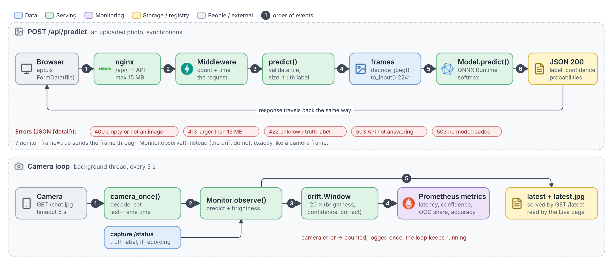
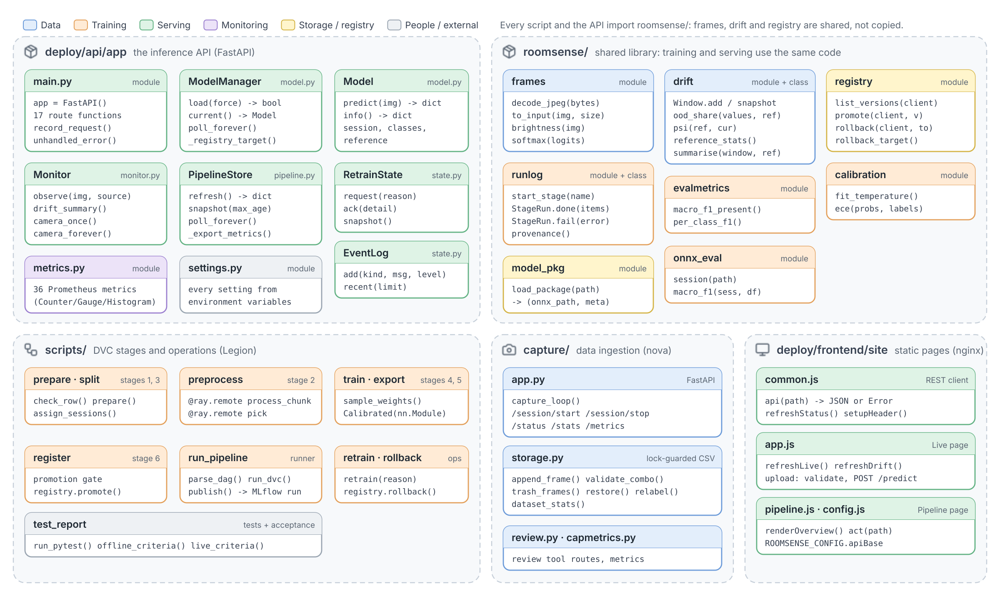

# RoomSense: Low-Level Design (LLD)

Endpoint definitions with input/output specifications, the modules and classes behind them, file formats, metrics and configuration. Design rationale is in [02-hld.md](02-hld.md).

## 1. Conventions

- **Base URL.** Inside Docker the API listens on `http://api:8000`. Browsers reach it through the frontend's nginx at `https://nova.tailb5cb87.ts.net:4443/api/…` (the prefix `/api` is stripped by the proxy; FastAPI knows it as `root_path`).
- **Format.** JSON in, JSON out, UTF-8, except `POST /predict` (multipart upload), `GET /latest.jpg` (JPEG) and `GET /metrics` (Prometheus text).
- **Errors.** Every error is `{"detail": "<message a person can read>"}` with a meaningful status code. Unexpected exceptions return `500 {"detail": "Internal error", "error_id": "<8 hex>"}`; the traceback goes to the log under the same id.
- **Authentication.** Access is limited to the tailnet. State-changing endpoints marked 🔒 also require the header `X-Token: <RETRAIN_TOKEN>` when that setting is non-empty (403 otherwise).
- **Times.** Unix seconds (float) unless stated.
- **Interactive spec.** FastAPI serves OpenAPI at `/api/docs` and `/api/openapi.json`. A test (`test_openapi_documents_every_endpoint`) keeps it in step with this document.

## 2. Inference API endpoints

### 2.1 Live room

#### `GET /health`
Liveness and readiness. Always 200 while the process runs.

| Field | Type | Meaning |
|---|---|---|
| `status` | string | `"ok"` |
| `model_loaded` | bool | A model is in memory |
| `model_version` | string or null | Registry version being served |
| `model_error` | string or null | Last model-load error |
| `camera_error` | string or null | Last camera error (null when the camera answers) |
| `camera_enabled` | bool | The camera loop is configured |
| `uptime_seconds` | int | Since process start |

#### `GET /model`
Details of the serving model. **503** if none is loaded.

`{"version": "2", "run_id": "…", "uri": "models:/roomsense@champion", "classes": ["at_desk", …], "metrics": {"test_macro_f1": 0.71, "test_accuracy": …, "val_macro_f1": …, "test_per_class_f1": {…}, "test_classes_absent": []}, "data_include": {}, "created_at": "ISO time", "train_frames": 900, "reference_brightness_mean": 118.2, "loaded_at": 1794400000.0}`

#### `POST /predict`
Classify one uploaded image.

| Input | Where | Type | Notes |
|---|---|---|---|
| `file` | multipart form field | JPEG / PNG / WebP, ≤ 15 MB | required |
| `monitor_frame` | query | bool, default `false` | `true` also feeds the drift window and metrics (used by the drift demo) |
| `truth` | query | string, optional | Ground-truth class for live accuracy; only with `monitor_frame=true` |

Response 200:

| Field | Type | Meaning |
|---|---|---|
| `label` | string | Predicted class |
| `confidence` | float 0–1 | Calibrated probability of `label` |
| `probabilities` | object class → float | All six, sum to 1 |
| `latency_ms` | float | Model time only |
| `brightness` | float 0–255 | Mean grey level of the image |
| `model_version` | string | Version that answered |
| `timestamp`, `source`, `truth`, `correct` | | Present only with `monitor_frame=true` |

Errors: **400** empty file or not an image · **413** larger than 15 MB · **422** missing `file`, or `truth` is not a known class · **503** no model loaded.

#### `GET /latest`
The most recent camera prediction: the `/predict` fields plus `timestamp`, `source: "camera"`, `truth` (label of the active capture session, or null), `correct` (bool or null) and `camera_error`. **404** before the first frame.

#### `GET /latest.jpg`
The most recent camera frame, `image/jpeg`, `Cache-Control: no-store`. **404** before the first frame.

#### `GET /drift`
Summary of the drift window (the last `DRIFT_WINDOW` = 120 monitored frames).

| Field | Type | Meaning |
|---|---|---|
| `window` | int | Frames in the window |
| `ood_share` | float or null | Share of frames in brightness bins (almost) unseen in training. The alert signal. |
| `psi` | float or null | Population Stability Index of the brightness histogram (informational) |
| `threshold`, `min_samples` | float, int | Alert threshold (0.5) and minimum window (30) |
| `drifting` | bool | `ood_share > threshold` with enough samples |
| `brightness_mean`, `reference_brightness_mean` | float | Live vs training |
| `current_hist`, `reference_hist` | float[16] | Normalised brightness histograms |
| `confidence_mean`, `reference_confidence_mean`, `low_confidence_ratio` | float | Live vs validation confidence |
| `live_accuracy`, `labelled` | float or null, int | Accuracy against capture-session labels, and how many frames had one |

### 2.2 Pipeline console

#### `GET /pipeline`
Everything the Pipeline page's overview needs. Query `refresh=true` rebuilds the snapshot from MLflow first (otherwise a cached snapshot, refreshed every 60 s, is returned). Never fails because MLflow is down: `mlflow_up` turns false and `errors` says why.

| Field | Type | Meaning |
|---|---|---|
| `generated_at` | float | When the snapshot was built |
| `mlflow_up` | bool | MLflow answered |
| `errors` | string[] | Human-readable problems |
| `dag` | `{stages: [{name, cmd, deps[], outs[]}], edges: [[from, to]]}` | The DVC DAG as parsed from `dvc.yaml` by the latest run (a built-in copy before the first run) |
| `stage_info` | object stage → `{title, tool, machine, what}` | Plain-language description of each stage, plus `capture` and `serve` |
| `latest` | run object or null | Latest pipeline run (below) |
| `last_success` | run object or null | Latest successful run (source of the throughput tiles) |
| `summary` | `{runs_total, runs_ok, runs_failed, success_rate, last_success_at, last_failure_at, training_runs, model_versions, champion}` | Counts |
| `ingestion` | `{available, frames_total, sessions_total, per_class: {label: {frames, sessions}}, per_lighting, first_frame_at, last_frame_at, frames_today, disk_free_bytes, recording, interval_seconds}` | From the capture service's `/stats` (`available: false` + `error` when it does not answer) |
| `retrain` | object | Same as `GET /retrain` |

**Pipeline run object:** `{run_id, status: "FINISHED"|"FAILED"|"RUNNING", ok, started_at, seconds, trigger, reason, host, git_commit, git_dirty, data_version, failed_stage, error, model_version, promoted, stages: {name: {status: "ok"|"cached"|"failed"|"not_reached", seconds, items, throughput_per_s}}, headline: {frames_raw, frames_valid, frames_kept, sessions, ray_resize_fps, preprocess_fps, train_images_per_s, test_macro_f1, latency_ms_p95}}`

#### `GET /pipeline/runs`
Query `limit` (1–50, default 20; **422** outside). Returns `{generated_at, summary, pipeline_runs: [run object], training_runs: [{run_id, name, status, started_at, seconds, git_commit, data_version, test_macro_f1, test_accuracy, best_val_macro_f1, train_images_per_s, train_frames, classes}]}`.

#### `GET /pipeline/registry`
`{model, alias, champion, serving, rollback_target, versions: [{version, run_id, created_at, is_champion, test_macro_f1, decision, previous_champion, rolled_back_at, git_commit, data_version, data_include}]}`. `serving` is what the API has in memory; `champion` is what the registry says.

#### `POST /pipeline/rollback` 🔒
Query `version` (optional; default: the version the champion replaced) and `reason`. Moves the alias, reloads the model, refreshes the snapshot.
Response 200: `{champion, rolled_back_from, reason, reloaded}`. Errors: **409** nothing to roll back to / already champion / unknown version · **503** MLflow not configured or not answering · **403** bad token.

#### `GET /events`
Query `limit` (1–200, default 50). `{events: [{at, last_at, kind: "alert"|"retrain"|"model"|"rollback"|"camera"|"api", level: "info"|"success"|"warning"|"error", message, count}]}`, newest first. Identical consecutive events are merged and counted.

### 2.3 Model lifecycle

| Endpoint | Input | Output |
|---|---|---|
| `POST /reload` | query `force` (bool) | `{reloaded, version, error}`. Checks the registry alias now. |
| `POST /hooks/alertmanager` | Alertmanager webhook JSON: `{alerts: [{status, labels: {alertname, action}, annotations: {summary}}]}` | `{retrain_requested, reasons[]}`. A firing alert with label `action=retrain` raises the flag. **400** if the body is not JSON. |
| `GET /retrain` | none | `{requested, reason, requested_at, history: [{done_at, version, promoted, …}]}` |
| `POST /retrain/request` 🔒 | query `reason` | `{raised}` (false if already raised) |
| `POST /retrain/ack` 🔒 | JSON object `{started, reason, version, promoted, detail, pipeline_run_id, seconds}` | The `/retrain` object. Clears the flag, reloads the model. **400** if not a JSON object. |

### 2.4 Monitoring

`GET /metrics` returns Prometheus text. Section 6 lists the series.

## 3. Capture service endpoints (data ingestion)

Base: `http://roomsense-capture:8100` (tailnet: `https://nova.tailb5cb87.ts.net:7443`).

| Endpoint | Input | Output |
|---|---|---|
| `GET /` | none | The phone page with label buttons |
| `POST /session/start` | `{label, lighting}` | `{session_id}`. **400** unknown label or lighting, or an impossible pair (`lights_off` + `tube_on`). |
| `POST /session/stop` | none | `{stopped, frames}` |
| `GET /status` | none | `{session: {id, label, lighting} or null, frames, last_error, interval_seconds}` |
| `GET /stats` | none | Dataset totals (the `ingestion` object above, without `available`) |
| `GET /metrics` | none | Prometheus text |
| `GET /latest.jpg` | none | Last captured frame |
| `GET /review`, `/api/sessions…`, `POST /api/trash`, `/api/relabel`, `/api/lighting`, `/api/trash/{id}/restore` | review tool | Browse sessions; trash, restore or relabel frames. Every action is appended to a curation log. |

## 4. Request flow

**Threads in the API process:** the web server's request threads; `ModelManager.poll_forever` (registry alias, every 60 s); `Monitor.camera_forever` (every 5 s); `PipelineStore.poll_forever` (MLflow snapshot, every 60 s). Shared state is guarded by locks: the model swap, the drift window, the retrain file, the event log, the pipeline snapshot.

## 5. Modules and classes

### 5.1 `roomsense/` (shared by training and serving)

| Module | Public interface | Notes |
|---|---|---|
| `frames` | `decode_jpeg(bytes) -> BGR array` (raises `ValueError`), `to_input(img, size) -> float32 [1,3,H,W]`, `brightness(img) -> float`, `softmax(logits)` | The one preprocessing implementation. Training, export and the API all call it, which rules out train/serve skew. |
| `drift` | `Window(maxlen).add(brightness, confidence, correct)`, `.snapshot()`; `histogram(values)`; `ood_share(values, ref_hist, min_share)`; `psi(ref, cur)`; `reference_stats(brightness, confidence)`; `summarise(window, reference, low_conf)` | 16 brightness bins over 0–255. |
| `calibration` | `fit_temperature(logits, labels) -> float`, `ece(probs, labels) -> float` | Temperature scaling and Expected Calibration Error. |
| `evalmetrics` | `per_class_f1(y_true, y_pred, n)`, `macro_f1_present(y_true, y_pred, classes) -> {macro_f1, accuracy, per_class_f1, support, classes_evaluated, classes_absent, n}` | Averages over classes present in the ground truth. |
| `model_pkg` | `load_package(path) -> (onnx_path, meta)` | A model package is `model.onnx` + `model_meta.json`. |
| `onnx_eval` | `session(path, threads)`, `macro_f1(sess, df, classes)` | Evaluates an ONNX model on a split. |
| `registry` | `list_versions(client, name)`, `champion_version(…)`, `promote(client, name, version)`, `rollback_target(…)`, `rollback(client, name, alias, to_version, reason)` (raises `ValueError`), `seen_sessions(splits)`, `fair_comparison_set(test, champion_seen)` | Takes any object with MlflowClient's methods, so it is tested with a fake. |
| `runlog` | `setup_logging(name)`, `start_stage(name) -> StageRun`, `StageRun.done(items, unit, **extra)`, `.fail(error)`, `read_stage(name)`, `git_commit()`, `data_version()`, `provenance()` | Uniform logging and `reports/stages/<stage>.json`. |

### 5.2 `deploy/api/app/`

| Class / module | Responsibility | Key methods |
|---|---|---|
| `main` | FastAPI app: routes, request metrics middleware, global error handler, token check, background-thread start-up | 17 route functions |
| `Model` | One loaded ONNX session with its metadata | `predict(img) -> dict`, `info()` |
| `ModelManager` | Resolves the registry alias, downloads, swaps atomically | `load(force) -> bool`, `current()`, `poll_forever()` |
| `Monitor` | Per-frame bookkeeping: prediction, metrics, drift window, latest frame | `observe(img, source, truth, jpeg)`, `drift_summary()`, `update_drift_metrics()`, `camera_once()`, `camera_forever()` |
| `PipelineStore` | Cached snapshot of pipeline runs, training runs, registry, ingestion; mirrors it into Prometheus gauges | `refresh()`, `snapshot(max_age)`, `poll_forever()` |
| `RetrainState` | The retrain flag and history, persisted as JSON | `request(reason) -> bool`, `ack(detail)`, `snapshot()` |
| `EventLog` | Persistent activity log with de-duplication | `add(kind, message, level)`, `recent(limit)` |
| `metrics` | All Prometheus series | |
| `settings` | Every setting, read from environment variables | |

### 5.3 `scripts/`

| Script | Role | Reads → writes |
|---|---|---|
| `prepare.py` | Stage 1: data quality checks | `data/raw/frames.csv` → `data/processed/manifest.csv`, `reports/prepare_report.json` |
| `preprocess.py` | Stage 2: Ray tasks `process_chunk` (resize) and `pick` (k-means) | manifest + raw frames → `data/processed/images/`, `clean_manifest.csv`, `reports/preprocess_report.json`, cluster plots |
| `split.py` | Stage 3 | `clean_manifest.csv` → `splits.csv`, `reports/split_report.json` |
| `train.py` | Stage 4 | splits + images → `models/best.pt`, `calibration.json`, `train_run.json`, `reports/metrics.json`, confusion matrix; an MLflow run |
| `export.py` | Stage 5 | `best.pt` → `models/model.onnx`, `model_meta.json`, `reports/export_report.json` |
| `register.py` | Stage 6: promotion gate on test sessions unseen by the champion (`registry.fair_comparison_set`); stores `splits.csv` in the run | ONNX package → a registry version, `reports/register_report.json` (decision, both scores, the comparison set) |
| `backfill_splits.py` | Stores an older model's `splits.csv` in its MLflow run, recovered from the DVC cache via a commit's `dvc.lock` | `--version 2 --lock-rev <commit>` |
| `run_pipeline.py` | Runs `dvc repro`, records the run | → MLflow experiment `roomsense-pipeline`, `reports/pipeline_run.json` |
| `retrain.py` | Flag → git pull → dvc pull → pipeline → dvc push → commit → ack | |
| `rollback.py` | `--list`, `--to N` | Moves the champion alias |
| `test_report.py` | pytest + ruff + acceptance criteria | → `reports/tests/junit.xml`, `reports/acceptance.json`, `docs/05-test-report.md` |
| `nightly-snapshot.sh` | nova, 03:30 timer: `git pull --rebase`, `dvc add data/raw`, commit, `dvc push`, `git push` | |

### 5.4 Frontend (`deploy/frontend/site/`)

| File | Role |
|---|---|
| `config.js` | Generated at container start from `API_BASE_URL` and `LINK_*`. The only place that knows where the API is. |
| `common.js` | `api(path, options)`: the single REST client (turns failures into readable `Error`s); header, status pill, formatting helpers |
| `index.html` + `app.js` | Live room page: polls `/health`, `/latest`, `/drift`, `/model`, `/retrain`; uploads to `/predict` |
| `pipeline.html` + `pipeline.js` | Pipeline page: `/pipeline`, `/pipeline/runs`, `/pipeline/registry`, `/events`; actions `/retrain/request`, `/reload`, `/pipeline/rollback` |
| `help.html` | In-app user manual |

## 6. Prometheus metrics

**API (`roomsense_…`)**

| Series | Type | Labels | Meaning |
|---|---|---|---|
| `predictions_total` | counter | `label`, `source` | Predictions made |
| `inference_latency_seconds` | histogram | | Model latency |
| `prediction_confidence` | histogram | | Confidence distribution |
| `input_brightness`, `current_label` | gauge | `label` | The last frame |
| `model_info`, `model_version`, `model_loaded`, `model_reloads_total` | gauge / counter | `version` | Serving model state |
| `last_frame_timestamp_seconds`, `camera_errors_total` | gauge / counter | | Camera health |
| `drift_ood_share`, `drift_psi`, `drift_window_size` | gauge | | Drift window: the alert signal, PSI, frames |
| `window_brightness_mean`, `reference_brightness_mean`, `window_confidence_mean`, `reference_confidence_mean`, `window_low_confidence_ratio` | gauge | | Live window vs training reference |
| `live_accuracy`, `labelled_frames_total` | gauge / counter | | Accuracy against capture labels |
| `retrain_pending`, `retrain_requests_total`, `retrains_completed_total` | gauge / counter | | Retrain loop |
| `http_requests_total`, `http_request_seconds` | counter / histogram | `method`, `path`, `status` | The API's own traffic |
| `dependency_up` | gauge | `dependency` = mlflow, camera, capture | What the API can reach |
| `model_rollbacks_total` | counter | | Rollbacks through the API |
| `pipeline_last_run_success`, `pipeline_last_run_timestamp_seconds`, `pipeline_last_run_seconds`, `pipeline_runs`, `pipeline_stage_seconds`, `pipeline_stage_throughput`, `pipeline_ray_resize_fps`, `registry_versions` | gauge | `stage`, `result` | The training pipeline, from MLflow |

**Capture service (`roomsense_capture_…`):** `frames_total{label, lighting}`, `camera_errors_total`, `save_errors_total`, `session_active`, `sessions_started_total{label}`, `last_frame_timestamp_seconds`, `fetch_seconds` (histogram), `curation_actions_total{action}`, `dataset_frames{label}`, `dataset_sessions{label}`, `disk_free_bytes`.

**From exporters:** `node_*` (host CPU, memory, disk, temperature, battery), `container_*` (per container), `nginx_*` (frontend requests), plus the built-in metrics of Prometheus, Alertmanager and Grafana.

**Alert rules (13, `deploy/prometheus/alerts.yml`):** RoomSenseDrift and RoomSenseLiveAccuracyDrop (both `action=retrain`), RoomSenseLowConfidence, RoomSenseAPIDown, RoomSenseNoModel, RoomSenseCameraStale, RoomSenseSlowInference, RoomSenseComponentDown, RoomSenseMLflowDown, RoomSensePipelineFailed, RoomSenseCaptureCameraErrors, NovaDiskAlmostFull, NovaMemoryLow.

## 7. Files and formats

| File | Format |
|---|---|
| `data/raw/frames.csv` | CSV: `path, session_id, label, lighting, timestamp` (ISO 8601, +05:30) |
| `data/processed/manifest.csv` | Same + `period` (`day` 06:00–17:59, else `night`) |
| `data/processed/clean_manifest.csv` | Same + `faces_blurred` |
| `data/processed/splits.csv` | Same + `split` (`train` / `val` / `test`) |
| `models/model_meta.json` | `{classes, img_size, temperature, reference: {brightness_hist[16], brightness_mean, confidence_mean}, metrics, data_include, train_frames, created_at, git_commit, data_version}` |
| `reports/stages/<stage>.json` | `{stage, status: running|ok|failed, started_at, finished_at, duration_s, items, unit, throughput_per_s, git_commit, error}` |
| `reports/pipeline_run.json` | The run object published to MLflow, with the DAG |
| `reports/acceptance.json` | `{generated_at, git_commit, thresholds, tests, criteria: [{id, criterion, measured, status, source}]}` |
| `deploy/data/api/retrain.json`, `events.json` | The retrain flag and the activity log |

## 8. Configuration

`params.yaml` holds every pipeline parameter (sections `prepare`, `split`, `data`, `preprocess`, `train`, `export`, `register`, `acceptance`); DVC reruns a stage when its section changes.

API settings (environment variables, defaults in `deploy/api/app/settings.py`, values in `deploy/.env`):

| Variable | Default | Meaning |
|---|---|---|
| `MODEL_URI` | `models:/roomsense@champion` | What to serve (a local folder also works) |
| `MODEL_POLL_SECONDS` | 60 | Registry poll interval |
| `MLFLOW_TRACKING_URI` | `http://mlflow:5000` | Tracking server |
| `CAM_URL`, `CAM_USER`, `CAM_PASS`, `CAMERA_INTERVAL_SECONDS` | –, –, –, 5 | Camera |
| `CAPTURE_STATUS_URL` | `http://roomsense-capture:8100/status` | Ground-truth label source |
| `DRIFT_WINDOW`, `DRIFT_MIN_SAMPLES`, `OOD_THRESHOLD`, `OOD_MIN_SHARE`, `LOW_CONFIDENCE` | 120, 30, 0.5, 0.005, 0.6 | Drift detection |
| `RETRAIN_TOKEN` | empty | Shared secret for 🔒 endpoints |
| `PIPELINE_POLL_SECONDS`, `PIPELINE_EXPERIMENT`, `TRAIN_EXPERIMENT` | 60, `roomsense-pipeline`, `roomsense` | Pipeline console |
| `CORS_ORIGINS` | empty | Origins allowed to call the API directly |
| `ROOT_PATH`, `STATE_DIR`, `LOG_LEVEL`, `ORT_THREADS` | `/api`, `/state`, `INFO`, 2 | Runtime |

Frontend settings: `API_UPSTREAM` (default `http://api:8000`), `API_BASE_URL` (default `api/`), `LINK_GRAFANA`, `LINK_MLFLOW`, `LINK_PROMETHEUS`, `LINK_CAPTURE`.

## 9. Logging and error handling

- **Logging.** Every script and service uses Python `logging` with one format: `time level logger message`. Level comes from `LOG_LEVEL`. Pipeline scripts get their logger from `runlog.start_stage`, which also records start, end, duration and failure of the stage.
- **Pipeline failures.** An uncaught exception in a stage is written to `reports/stages/<stage>.json` by an exception hook, `dvc repro` stops, and `run_pipeline.py` records the run as FAILED in MLflow with the failed stage and the log tail. The Pipeline page shows it and the `RoomSensePipelineFailed` alert fires.
- **API.** Bad input → 4xx with a readable message. A missing dependency → 503. Background loops catch their own errors, count them in a metric, log once per state change and keep running. MLflow calls have a 15 s timeout and 2 retries so a dead tracking server cannot hang the API; the model already in memory keeps serving.
- **Capture.** A camera or disk error is counted, shown in `/status` and never stops the loop.
- **Frontend.** Every REST failure becomes a sentence on the page: an offline banner, a message next to the control that failed, or an explanatory empty state. No browser alert boxes.
