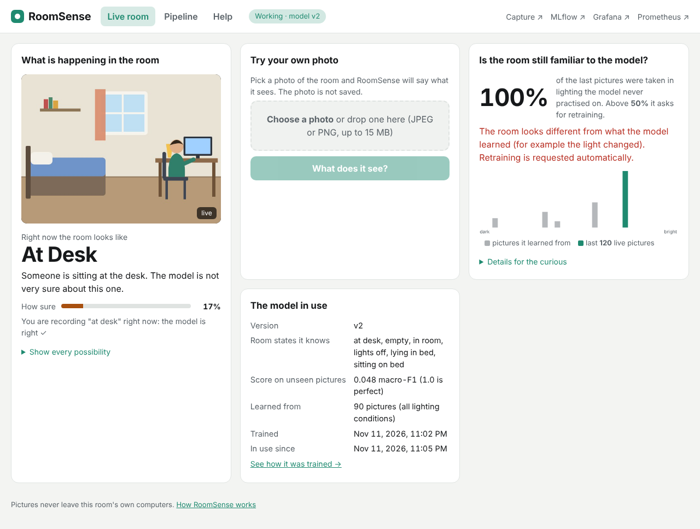
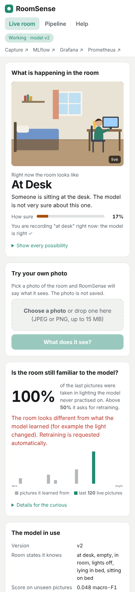
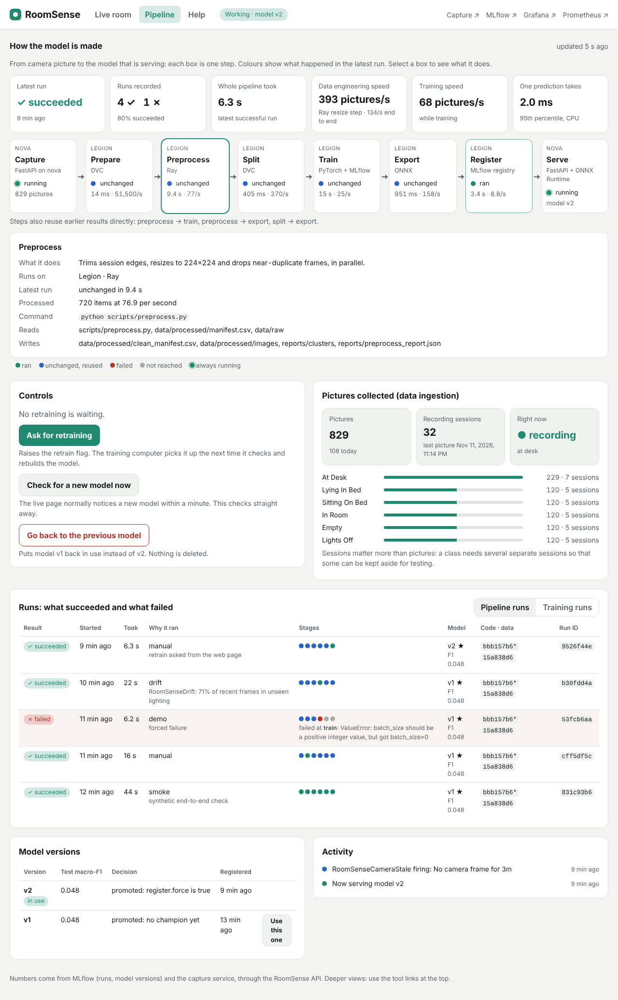

# RoomSense: user manual

For anyone who wants to use RoomSense. No technical knowledge needed.

> The screenshots in this copy were taken on a test set-up with a drawn sample room instead of the real camera picture. The pages look the same on the real system.

## 1. What RoomSense does

A phone on a shelf takes a picture of the room every five seconds. RoomSense looks at each picture and says what is going on in the room, in one of six ways:

| RoomSense says | It means |
|---|---|
| **at desk** | Someone is sitting at the desk. |
| **lying in bed** | Someone is lying down in bed. |
| **sitting on bed** | Someone is sitting up on the bed. |
| **in room** | Someone is in the room, standing or moving about. |
| **empty** | Nobody is in the room and it is lit. |
| **lights off** | The room is dark. |

It also watches itself: if the room starts to look different from what it learned (for example the lighting changes), it notices, sends an alert, and gets retrained.

## 2. Opening it

1. Make sure the **Tailscale** app on your phone or laptop is switched on. (RoomSense is private: it only opens on the owner's own devices.)
2. Open this address in any browser: **https://nova.tailb5cb87.ts.net:4443**

That is all. There is nothing to install and no password.

At the top of every page:

- **Live room · Pipeline · Help**: the three pages.
- **A coloured pill**: green = working. Orange = something needs attention (no model yet, or the camera stopped). Red = this device can't reach RoomSense.
- **Capture, MLflow, Grafana, Prometheus**: links to the engineering tools. You can ignore them.

## 3. The Live room page

**What is happening in the room** (left):

1. The picture is the newest one from the camera. The tag in its corner says *live*, or how many seconds old it is.
2. The big words are the answer, followed by one sentence that explains it.
3. **How sure** shows how confident RoomSense is. Below 60% the bar turns orange and the page says it is not very sure.
4. **Show every possibility** opens the full list with a percentage for each of the six states.

The page refreshes by itself every three seconds. You never need to reload it.

**Try your own photo** (top right):

1. Select **Choose a photo**, or drag a photo onto the dotted box.
2. Select **What does it see?**
3. The answer appears next to your photo.

JPEG and PNG photos up to 15 MB work. The photo is used once and not saved. RoomSense learned one particular room from one camera position, so a photo of a different room gets an answer that means nothing.

**Is the room still familiar to the model?** (bottom right)

RoomSense only knows what it has practised on. If it learned with the tube light on and the light goes off, its answers get worse. This box watches for that.

- The **big percentage** is the share of recent pictures taken in lighting it never practised on.
- **Green message**: all good.
- **Orange message**: some pictures are unusual. Nothing to do.
- **Red message**: more than half are unfamiliar. After five minutes RoomSense sends an alert and asks to be retrained. When the new model arrives, the number drops back by itself.
- The **bar chart** compares the brightness of the pictures it learned from (grey) with the last ten minutes (green).

**The model in use** shows which version is answering and how well it scored when tested.

On a phone the same boxes are stacked in one column:

## 4. The Pipeline page

This page shows how the model is made, and lets you manage it.

**How the model is made.** The row of boxes is a production line, left to right: collect pictures → check them → tidy them → split them → train → convert → register → serve.

- A **green** dot: the step ran. **Blue**: nothing had changed, so the earlier result was reused. **Red**: it failed. **Grey**: it was not reached.
- Select a box to read what that step does.
- The tiles above give the headline numbers: did the latest run succeed, how long does the whole line take, how many pictures per second it handles.

**Controls.**

| Button | What it does | When to use it |
|---|---|---|
| **Ask for retraining** | Queues a rebuild of the model. The training computer starts it the next time it checks. | The answers have been wrong for a while |
| **Check for a new model now** | Makes the Live page switch to a new model immediately instead of within a minute | Right after a retraining finished |
| **Go back to the previous model** | Puts the previous model back in use. Asks you to confirm. Nothing is deleted, and you can switch again. | A new model is worse than the one before |

If a button answers "this server wants the admin token", ask the owner for it, type it in the box that appeared, and select the button again.

**Pictures collected.** How many pictures and recording sessions exist for each room state, and whether a recording is running right now.

**Runs: what succeeded and what failed.** Every time the production line ran, newest first, with ✓ or ✗. For a failed run it names the step that failed and the reason. *Training runs* shows the score of each model that was trained.

**Model versions.** Every model ever made. The one marked **in use** is answering on the Live page. **Use this one** switches to any other version.

**Activity.** A diary: alerts, retraining requests, model changes, camera drop-outs.

## 5. Recording new pictures (owner only)

Open **Capture** from the top of the page (or https://nova.tailb5cb87.ts.net:7443).

1. Choose the lighting (tube on / tube off).
2. Tap the button for what you are about to do, for example **at_desk**. Recording starts: one picture every five seconds.
3. Do that one thing for 5 to 10 minutes.
4. Tap **Stop**.

Short, separate sessions in different clothes, positions and times of day teach the model more than one long session. **Review** on that page lets you delete or relabel pictures that came out wrong.

## 6. If something looks wrong

| What you see | What to do |
|---|---|
| Red pill: **Offline** | Open the Tailscale app, switch it on, wait a few seconds. The page reconnects by itself. |
| Orange pill: **camera offline**, or the picture's tag shows many seconds | Check the camera phone: is it charging, on the room Wi-Fi, with the IP Webcam app open and "Start server" running? |
| Orange pill: **No model yet** | The model has not been trained on this server yet. It appears by itself after the first training run. |
| The answer is clearly wrong | One wrong answer is normal. If it stays wrong, look at "Is the room still familiar?". Red means retraining is already on its way. Otherwise select **Ask for retraining** on the Pipeline page. |
| "That file is not a photo" | Choose a JPEG or PNG picture. |
| A new model made things worse | Pipeline page → **Go back to the previous model** → confirm. |
| The Pipeline page says "MLflow is not answering" | The page keeps showing the last information it had. Tell the owner. |

## 7. Privacy

- Pictures stay on the two computers in the room and their backup drive. Nothing goes to a cloud service.
- The pages open only on devices in the owner's private Tailscale network.
- Pictures are saved only while the owner runs a recording session. The live view is not recorded.
- Photos you upload to "Try your own photo" are not saved.
